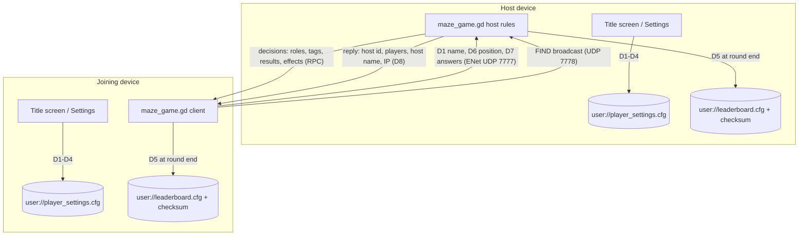

# Player Data, Security and Service Component (SA5 data inventory · PT5)

**Version:** 1.1.0 · **Identity model:** local profile (no account)

## 1. Data inventory

| # | Data item | Source | Where it is kept | Who can access it | Sent over the network? | How it is deleted / reset |
|---|---|---|---|---|---|---|
| D1 | Player display name (max 16 chars) | Typed on the title screen | `user://player_settings.cfg` [player] name | This device | Yes, to the LAN host and the other players in the game | Settings → Reset my data |
| D2 | Audio settings (music/sfx on, volume) | Settings window | `user://player_settings.cfg` [audio] | This device | No | Reset my data |
| D3 | Touch controls, vibration, Show FPS toggles | Settings window | `user://player_settings.cfg` [controls] | This device | No | Reset my data |
| D4 | Best solo round cleared (0–4) | End of a won solo round | `user://player_settings.cfg` [solo] best_round | This device | No | Reset my data |
| D5 | Leaderboard rows: name, games, wins, correct, tags, rescues, points + checksum | End of every LAN round | `user://leaderboard.cfg` | This device | No (each device keeps its own) | Reset my data |
| D6 | Character position (≈30 per second) | Gameplay | Memory only | Host and other players | Yes (LAN) | Ends with the round |
| D7 | Answers, help requests, station requests | Gameplay | Memory only (host) | Host | Yes (to the host) | Ends with the round |
| D8 | Device IP address and a random host id | Network | Memory only | Players on the same network (shown in the Host window) | Yes (LAN discovery, UDP 7778; game, UDP 7777) | Ends when the game closes |

Not collected: real names, emails, location, contacts, analytics, advertising IDs. No
internet service, no cloud account.

## 2. Data-flow diagram

## 3. Identity model and justification

**Chosen: local profile, no account.** The game is played face-to-face on a shared
Wi-Fi/hotspot, often by students without data plans. An online account would add sign-up
friction, a dependency on internet access, and personal data to protect, with no
gameplay benefit. The profile is a display name plus settings and progress, stored only on
the device. "Reset my data" acts as sign-out/profile reset.

## 4. Controls implemented

| Control | Where | What it protects against |
|---|---|---|
| Name validation: 1–16 chars, letters/numbers/space/`- _ . '`/ñ; clear error message | `GameState.name_problem()`, title screen | Very long or markup names breaking other players' screens or the leaderboard file |
| Server-side name cleaning for every joining player | `Network._register_player_name` → `GameState.clean_name()` | A modified client sending a bad name |
| Host-authoritative rules: only the player who owns a question may answer it; station use is checked for role, distance, cooldown and retry wait | `maze_game.gd` `_host_receive_answer`, `_host_try_interact` | A client giving itself points or power-ups |
| A 7th player and joins after the start are refused | `network.gd _on_peer_connected` | Overfilled or hijacked rounds |
| Leaderboard checksum (SHA-256 of the rows). A file that can't be read or was edited is moved to `leaderboard.cfg.bad` and the board starts fresh, with a message | `data/leaderboard.gd` | Hand-edited scores; a crash on a damaged file. *This is a tamper check, not encryption. No secret key is used, so it stops casual edits, not a determined attacker* |
| Every saved setting is type-checked when loaded | `GameState._load_settings()` | A damaged settings file crashing the game |
| Reset my data (two taps to confirm, disabled mid-round) | Settings window | Lets a player remove everything the game stored |
| No secrets in the repository: no API keys or service credentials exist; Android keystore passwords are blank in `export_presets.cfg` (Godot keeps real ones in the git-ignored `.godot/` folder) | `.gitignore`, `export_presets.cfg` | Leaked credentials |

## 5. Tests (executed)

Run: `godot --headless --path . --script tools/tests/test_data.gd` (backs up and restores your real save files).
Executed 2026-11-10 on the development PC (Windows 11, Godot 4.7.2), by Claude (AI assistant) during development.

| ID | Case | Expected | Actual | Status |
|---|---|---|---|---|
| DT-01 | Valid name "Stef Cerezo" | Accepted | Accepted | Pass |
| DT-02 | Empty name | Rejected with message | Rejected | Pass |
| DT-03 | 17-character name | Rejected | Rejected | Pass |
| DT-04 | Name with symbols `Ana\|<b>` | Rejected | Rejected | Pass |
| DT-05 | LAN name `  Ben\|x[b]  ` cleaned by host | `Benxb` | `Benxb` | Pass |
| DT-06 | LAN name of only symbols | `Player` | `Player` | Pass |
| DT-07 | Round saved, Ana won + 2 correct + 1 rescue | 6 points | 6 | Pass |
| DT-08 | Leaderboard edited by hand (6 → 999 points) | Detected, file moved to .bad, board empty, message shown | As expected | Pass |
| DT-09 | Leaderboard file not readable | Empty board, message, no crash | As expected | Pass |
| DT-10 | Reset my data | Name "Player", progress 0, board empty | As expected | Pass |

**To do yourself (PT5 evidence):** repeat DT-01, DT-02, DT-08 and DT-10 by hand on your
phone and take captioned screenshots; test LAN with Wi-Fi turned off mid-join (expect "Could
not connect…" and a return to the title screen).
