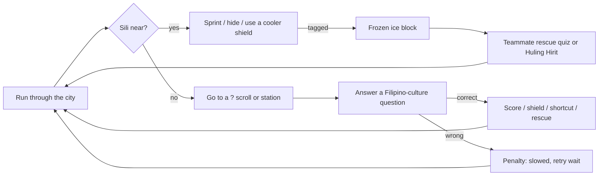

# Theme, Player and Game-Integration Analysis (SA5)

**Game:** Sili-Tubig: Task Avenue · **Version:** 1.1.0 · **Engine:** Godot 4.7.2 · **Platform:** Android (landscape), Windows for development
**Theme:** Board Games or Brain Games (trivia chase), built on the Filipino street game *sili-tubig*

## 1. Theme-to-Mechanics Justification

*Sili-tubig* is a tag game Filipino kids play in the street: the "sili" (chili) tags
players, who freeze until a free teammate saves them with "tubig" (water). This game keeps
that loop and makes knowledge the thing that saves you. Every rescue, power-up and shortcut
is a quiz about Filipino culture. The theme changes the rules and the decisions, not only
the art.

| Theme element | Mechanic | Player decision it creates |
|---|---|---|
| Sili tags, tubig saves (street game) | Sili freezes Tubig by touch; frozen Tubig become ice blocks | Run, hide behind buildings, or go back for a frozen teammate |
| Splashing water to rescue | **Buhos-Tubig**: touch a frozen teammate and answer 1 question to free them | Risk stopping next to a Sili to answer, or keep running |
| Knowing your culture | "?" scrolls: 10 correct answers win for the Tubig team | Go for the scroll the Sili may be guarding, or ask a teammate for help |
| Last chance (*huling hirit*) | Self-thaw with 2 hard questions in a row when no one can help | Only works if you really know the answers |
| Cold Filipino refreshments | **Halo-Halo / Mais Con Yelo / Sago't Gulaman / Buko Pandan coolers**: Yelo Shield for 10 s; a Sili who tags you is extinguished for 5 s | Detour to a cooler before crossing a dangerous street |
| Spicy Bicol food | **Bicol Express pepper** (Sili only): solve a *bugtong* (riddle) for Extra Anghang, faster with a wider reach | The Sili gives up chase time for a stronger chase |
| Sour kalamansi | **Kalamansi gates**: answer to squeeze through a shortcut; a wrong answer slows you 3 s | Take the shortcut and risk the slow-down, or take the long road |
| Filipino city streets | Maze painted as a city (jeepneys, tricycles, sari-sari stores) | Learn the streets on the MAPA |

Question content (`data/questions.gd`): Philippine myths, epics, traditions, dances, games,
food and places (49 general), harder history/geography (16), and Tagalog *bugtong* (14).

## 2. Target player

- **Who:** Filipino senior high and college students, and *barkada* groups who want short
  party rounds on their phones (2–6 players on the same Wi-Fi or hotspot), or solo practice
  against bots.
- **Experience goal:** a fast, noisy chase where knowing your culture is the way to win
  and to save your friends.
- **Needs:** short rounds (1:30–3:00); controls that work on a phone (joystick + RUN + USE);
  readable questions with a fun fact after each one; no account or internet needed.

## 3. Core gameplay loop

Win: Tubig team answers the goal number of questions. Loss: every Tubig frozen at once, or time
runs out. Solo progression: 4 rounds, Easy → Labuyo.

## 4. Integration analysis

| Part | How it is built | Why |
|---|---|---|
| Multiplayer | Godot ENet, host-authoritative RPCs (`scenes/maze_game.gd`), own UDP LAN discovery (`autoloads/network.gd`) | Works offline on a hotspot; the host decides tags, answers and power-ups, so clients can't cheat by changing their own results |
| Player data | Local profile only: name, settings, solo progress, leaderboard in `user://` (see `DATA_AND_SECURITY.md`) | No accounts are needed for LAN party play; nothing personal leaves the device except the display name over LAN |
| Bots | `scenes/bot_sili.gd`, adapted from the group project's BotBrain; difficulty table per round | Solo play and practice |
| Content | Question lists in `data/questions.gd`, randomized without repeats | Easy to extend with more Filipino content |
| Art | City tileset + character template (credited), generated with scripts in `tools/art/` | Consistent pixel style, reproducible |

## 5. Risks considered

| Risk | Handling |
|---|---|
| Venue Wi-Fi blocks device-to-device traffic | Phone hotspot recommended; type-the-IP fallback |
| A client sends a bad name or fake answer | Host cleans names (`GameState.clean_name`) and only accepts answers from the player who owns the question |
| Save file damaged or edited | Leaderboard checksum; a bad file is moved aside and the board starts fresh |
| A player leaves mid-round | Host times out their question and ends the round if a whole team is gone |
| Phone call / app switch mid-round | Round pauses when the app goes to the background |

*Student check: confirm the approved theme with your instructor and add your own words on
the target player before submitting SA5.*
